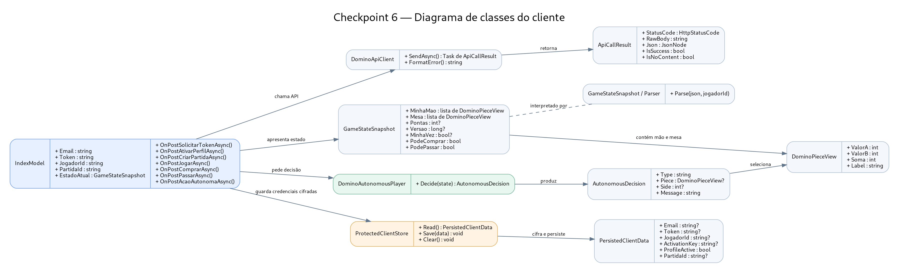
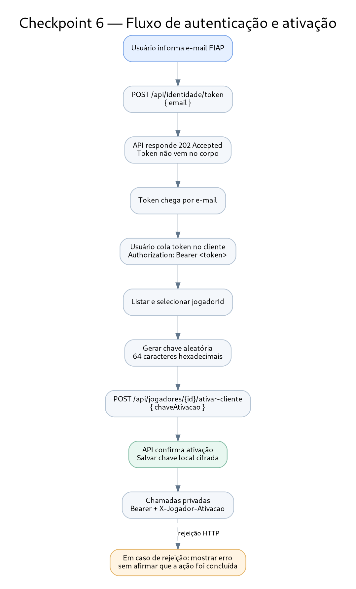

# Cliente Web - Dominó Ponta de Quina (Checkpoint 6)

Cliente ASP.NET Core Razor Pages (.NET 8) para consumir a API oficial descrita na apresentação do Checkpoint 6. A aplicação é separada da API criada anteriormente no projeto: ela chama o servidor remoto do professor.

## Pré-requisitos

- .NET 8 SDK instalado.
- Acesso à internet para alcançar a API oficial.
- Uma conta/e-mail FIAP e um perfil de jogador disponibilizado pela API.

## Endereço da API

O endereço base está configurado em `appsettings.json`:

`https://domino-quina-api-b1-pf2261.azurewebsites.net/`

Swagger oficial:

`https://domino-quina-api-b1-pf2261.azurewebsites.net/swagger`

O contrato detalhado da API é a referência final caso um corpo de requisição ou propriedade tenha sido alterado pelo servidor.

O perfil local abre o endereço `http://localhost:5187`. Se o navegador não abrir automaticamente, acesse esse endereço manualmente.

## Fluxo de uso

1. Informe seu e-mail FIAP e clique em **Solicitar acesso**. A API retorna `202 Accepted` e envia o token por e-mail; a resposta não contém o token.
2. Cole o token recebido e clique em **Guardar token nesta sessão**.
3. Liste os perfis disponíveis, selecione o `jogadorId` e clique em **Ativar neste cliente**. O cliente cria uma chave aleatória com 64 caracteres hexadecimais e mantém a mesma chave na sessão para permitir repetir a ativação em caso de resposta perdida.
4. Crie uma partida ou liste partidas disponíveis. Para ingressar, informe o ID da mesa.
5. Inicie ou consulte o estado da partida. Antes de enviar ações, atualize o estado para obter a versão atual.
6. Envie uma jogada informando `valorA`, `valorB` e o lado (0 = esquerda; 1 = direita), ou use comprar/passagem apenas quando a API permitir.
7. Use **Consultar atualizações** ou **Atualização automática** para acompanhar a versão do estado. A resposta `204 No Content` mantém o estado anterior.
8. Consulte o resultado oficial ao fim da partida.

## Diagramas

Diagrama de classes do cliente:



Fluxo de autenticação e ativação do perfil:



Os arquivos-fonte dos diagramas também estão disponíveis em formato Mermaid (`.mmd`) e Graphviz (`.dot`) dentro de `docs`.

## Jogador autônomo

O modo autônomo é uma heurística local demonstrativa: consulta o estado privado antes de decidir, busca uma peça compatível e escolhe a de maior soma. Quando a resposta da API indicar explicitamente que comprar ou passar é permitido, pode enviar essa ação. Com o modo ativado, um ciclo ocorre a cada cinco segundos enquanto a aba do cliente permanece aberta.

O jogador autônomo depende dos campos do estado retornado pela API. O parser usa nomes de propriedades comuns e prioriza o objeto do perfil selecionado; ele não exibe o JSON completo do estado privado, para não correr o risco de mostrar a mão de outro participante. Se a estrutura real da API for diferente, ajuste `Services/GameStateParser.cs` conforme os schemas do Swagger. O agente pausa quando a API rejeita uma ação.

## Segurança e comportamento

- O token e a chave de ativação ficam na sessão ASP.NET do lado do servidor; a chave de ativação não é exibida na interface.
- O estado transitório da página fica na sessão ASP.NET em memória; a credencial, a chave de ativação, o perfil e o ID da partida são persistidos separadamente em formato cifrado. Se o processo reiniciar, abra a página e consulte novamente o estado da partida para recuperar a versão mais recente.
- Desativar o modo autônomo não libera o perfil na API. Para transferir o perfil para outro cliente, use **Liberar perfil**.
- A API é a autoridade para distribuição das peças, validade das jogadas, compra, passagem, pontuação, vencedor e situação da partida.
- O cliente envia a versão esperada e uma chave UUID de idempotência para jogadas, compra e passagem. Erros 409 exigem atualização do estado; erros 422 significam que a API rejeitou a ação.

## Testes automatizados do cliente

Há um projeto de testes para validar a interpretação de estado, impedir que a mão de outro participante seja apresentada e verificar decisões básicas do agente autônomo.

Execute a partir da pasta `DominoPontaDeQuina.Client.Tests`:

```bash
dotnet test
```

## Verificação antes da entrega

Execute localmente os comandos abaixo, pois a compilação e uma partida real dependem do SDK .NET e do acesso à API no ambiente de desenvolvimento:

```bash
dotnet build DominoPontaDeQuina.Client/DominoPontaDeQuina.Client.csproj
dotnet test DominoPontaDeQuina.Client.Tests/DominoPontaDeQuina.Client.Tests.csproj
dotnet run --project DominoPontaDeQuina.Client/DominoPontaDeQuina.Client.csproj
```

Depois, teste o fluxo completo com dois perfis diferentes: ativar, criar/ingressar na mesa, iniciar, jogar, comprar ou passar quando permitido, acompanhar o placar e consultar o resultado. Capture evidências da interface, da mesa durante o turno e do jogador autônomo.

**Nota de integração:** o projeto foi montado com base nos endpoints e exemplos visíveis na apresentação fornecida. Não foi possível validar chamadas reais contra o Swagger remoto neste ambiente. Se o contrato atual exigir um corpo de requisição diferente ou expuser nomes de propriedades diferentes, ajuste o método correspondente usando o Swagger oficial antes da apresentação.
